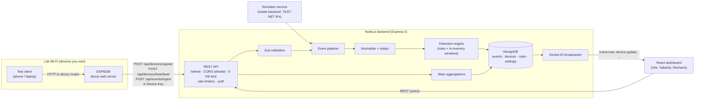
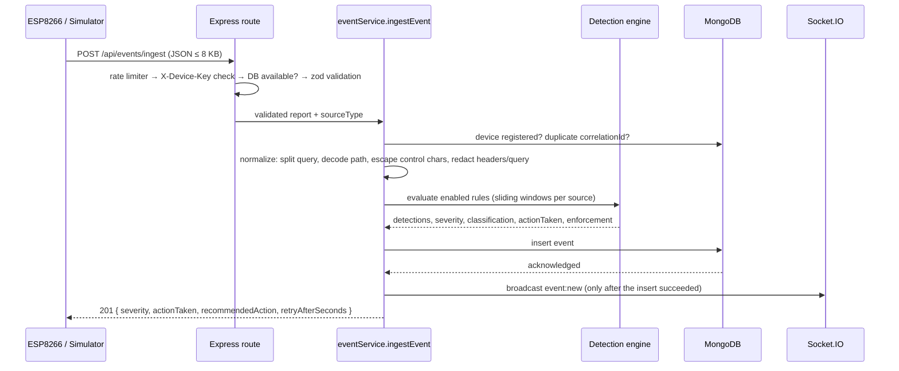

# Architecture

## System overview



The backend is the source of truth. The dashboard displays only what the API and socket events return; no metric is computed or invented in the browser.

## Ingestion pipeline



| Step | Where |
| --- | --- |
| 1. Validate | `src/validation/schemas.js` via `middleware/validate.js` (unknown fields stripped) |
| 2. Authenticate | `middleware/auth.js` (`X-Device-Key` constant-time compare; admin Bearer token) |
| 3. Normalize | `services/normalize.js` |
| 4. Redact | `utils/redact.js` (headers, query params, control characters, truncation) |
| 5. Detect | `detection/engine.js` + `detection/rules/*.js` |
| 6. Classify | `engine.js`: max severity, +1 escalation when ≥ 2 rules match, classification from severity |
| 7. Rate-limit decision | `detection/state.js` `EnforcementStore` (time-limited rate-limit/block per source) |
| 8. Persist | `services/eventService.js` → `models/Event.js` |
| 9. Update statistics | Computed on demand by MongoDB aggregations (`services/statsService.js`); no counters to drift |
| 10. Broadcast | `sockets/realtime.js`, after persistence |

The simulator (`services/simulatorService.js`) builds raw reports, validates them with the **same** `ingestEventSchema`, and calls the **same** `ingestEvent()` with `sourceType: "simulator", simulated: true`.

## Backend layout

```
backend/src
  config/       env.js (zod-validated env), database.js (connect/retry/status)
  models/       Event, Device, Rule, Setting (Mongoose schemas + indexes)
  validation/   zod request schemas
  middleware/   auth, guards (DB, simulator), validate, rate limiters, error handler, access log
  detection/    constants, engine, state (sliding windows, enforcement), rules/*
  services/     event pipeline, normalize, devices, rules, settings, stats, simulator, retention, API-429 recording
  controllers/  thin HTTP handlers
  routes/       route map (middleware order per route)
  sockets/      broadcast-only Socket.IO server
  utils/        logger, errors, redaction, security helpers, time buckets
  app.js        Express app factory (used by tests)
  server.js     HTTP server, Socket.IO, DB connection, background jobs, graceful shutdown
```

## Data model

**Event** (`events`): `timestamp` (server receive time), `sourceType` (`device|simulator|backend`), `simulated`, `deviceId`, `sourceIdentifier`, `clientIp`, `method`, `path` (sanitized, ≤ 512), `query` (redacted), `responseStatus`, `userAgent`, `loginResult`, `category`, `severity`, `severityRank`, `classification`, `detections[]` (`ruleId`, `ruleName`, `category`, `severity`, `reason`, `evidence`, `recommendedAction`), `detectionReasons[]`, `actionTaken`, `metadata` (redacted headers, sizes, device uptime, scenario), `correlationId` (unique when present), and `receivedAt`.

Indexes match the dashboard queries: `{timestamp:-1}`, `{sourceType:1,timestamp:-1}`, `{severityRank:-1,timestamp:-1}`, `{category:1,timestamp:-1}`, `{deviceId:1,timestamp:-1}`, `{simulated:1,timestamp:-1}`, and a partial unique index on `correlationId`. Free-text search uses an escaped, case-insensitive regex. That is fine at lab scale; a text index or search engine would be needed for large volumes.

**Device** (`devices`): `deviceId` (unique), name, hardware, firmware, IP, `registeredAt`, `lastHeartbeatAt`, `lastSeenAt`, device-reported `lastRssi`/`lastUptimeMs`/`lastFreeHeap`, `heartbeatCount`. Status is computed at read time from `lastHeartbeatAt` and the configurable timeout. It is never stored, and a device is never "online" just because it exists.

**Rule** (`rules`) stores only admin-editable config (`enabled`, `severity`, `action`, `params`). The logic lives in code. **Setting** (`settings`) is a singleton holding runtime settings. Both are cached in memory and seeded with defaults on first connect.

## Detection engine

Each rule module exports `{ id, name, description, category, defaultSeverity, defaultAction, defaultParams, paramFields, paramsSchema, evaluate(ctx, params) }`. `evaluate` returns `null` or `{ reason, evidence }`. To add a rule, create a module and append it to `detection/rules/index.js`. The API, Rules page and stats pick it up automatically.

| Rule | Signal | Notes |
| --- | --- | --- |
| `request-rate` | ≥ threshold requests per source in a sliding window | Starts a rate-limit decision |
| `failed-login` | ≥ threshold failures on the designated test login path(s) | Failure = `loginResult:"failed"` or 401/403 |
| `suspicious-path` | Path contains a configured pattern | Plain substring match, no regex (avoids ReDoS); described as a signal, not an attack |
| `malformed-request` | Non-standard method, traversal, null/control chars, oversized path/query, bad or double encoding | Lists every issue found |
| `not-found-repeat` | ≥ threshold 404s per source in a window | Route enumeration |
| `traffic-anomaly` | Device-wide requests/min > baseline × multiplier | Static configured baseline, not learned |

**Explainability.** Every match stores a human-readable `reason`, the `evidence` (counts, thresholds, the matched pattern) and the `recommendedAction`. If several rules match one request, the severity escalates one level and that is recorded as an extra reason. When a source is already under an active decision, an `active-enforcement` entry explains why the request was rate-limited or blocked.

**Limits of the rules.** They are threshold heuristics over what the device reports. They cannot see encrypted payloads or traffic the firmware does not forward, and they do not identify who controls a source IP (IPs can be shared, spoofed at higher layers, or NATed). They do not amount to complete intrusion detection.

### Short-term state and its limitations

Sliding-window counters (`SlidingWindowCounter`) and active decisions (`EnforcementStore`) live **in the backend process memory**.

- A restart resets counters and active decisions. Persisted events are unaffected.
- Memory is bounded: at most 20 000 keys and 2 000 timestamps per key, with idle keys swept every minute.
- **Distributed deployments** would need shared state. With several API instances, each would count separately and a source could spread requests across them. The usual fix is Redis: a sorted set per key, with `ZADD` for the timestamp, `ZREMRANGEBYSCORE` to drop old entries, `ZCARD` for the count and a TTL on the key. Enforcement decisions would become keys with `EX`. Express rate limiters would use a Redis store such as `rate-limit-redis`.

## Rate limiting vs. detection vs. blocking

| Layer | What it does | Where | What it is not |
| --- | --- | --- | --- |
| **API abuse protection** | Caps requests to the backend's own endpoints per client IP and returns **HTTP 429**. Stores one `api-rate-limit` event per limiter, client and window. | `middleware/rateLimiters.js` | It does not analyse honeypot traffic. |
| **Detection of suspicious activity** | Classifies requests the ESP8266 observed, with reasons. | `detection/` | It is not proof of an attack or attribution. |
| **Application-layer blocking** | Rules with `rate-limit`/`block` actions create a time-limited decision. Ingest responses carry `recommendedAction` and `retryAfterSeconds`, which the firmware uses to answer that client with 429/403. | `EnforcementStore`, firmware `enforceDecision()` | It is **not a network firewall**: no packets are dropped, other hosts are unaffected, and it relies on the firmware honouring it. |

API 429 events are written directly by `apiRateLimitService` and never pass through the detection engine. A flood of rejected requests therefore cannot generate a flood of new security events or trigger further rules.

## Security controls

| Control | Implementation | Dev-only setting to change before deployment |
| --- | --- | --- |
| Input validation | Zod on every body/query/param; unknown fields stripped; strict enums; allow-listed sort fields | - |
| Secure headers | `helmet()`; `x-powered-by` disabled | - |
| CORS | Explicit allowlist (`CORS_ORIGINS`); no wildcard | Set to the real dashboard origin |
| Body size | `express.json({ limit: '8kb' })` → 413 | - |
| Rate limiting | Separate public/device/simulator/probe limiters | Use a shared store if scaled out |
| Device auth | Shared `X-Device-Key`, SHA-256 + `timingSafeEqual` | Per-device credentials, TLS, rotation |
| Admin auth | Bearer `ADMIN_TOKEN` for mutations and simulator | Replace with real user auth/SSO; protect read APIs too |
| Read APIs | Unauthenticated for the lab dashboard | Put behind auth + HTTPS |
| Transport | Plain HTTP on the LAN | HTTPS (reverse proxy) |
| Simulator | `SIMULATOR_ENABLED` (default off in production), admin-only, TEST-NET IPs only, never sends network traffic | `SIMULATOR_ENABLED=false` |
| Secrets | Env vars only; reported as configured/not configured; never logged | Use a secret manager |
| Redaction | Authorization/cookie/token headers and sensitive query values → `[REDACTED]`; passwords and bodies never accepted | - |
| Safe strings | Control chars escaped as `\xNN`, lengths capped, regex input escaped, React escapes output | - |
| Error handling | Typed `AppError`s; internal errors return a generic 500, details in server log only | - |
| DB safety | Mongoose models, `strictQuery`, validated ObjectIds, no user-built operators; `bufferCommands:false` so writes fail fast | Enable MongoDB auth |
| Retention | Events older than `retentionDays` deleted hourly | - |
| `TRUST_PROXY` | Off by default so clients cannot spoof `X-Forwarded-For` | Enable only behind a proxy |

Not provided, by design: exploit tooling, credential capture (the decoy login never reads submitted values), command execution and network scanning.

## Frontend

React 19 + Vite 7, Tailwind CSS 4, React Router 7, Recharts 3, axios, Socket.IO client and Lucide icons. Pages are code-split per route.

- `context/SystemContext.jsx` polls `/api/health` every 15 s, tracks the Socket.IO connection and `system:database` events, and holds the admin session (session storage, per tab).
- `hooks/useApi.js` keeps the previous data while refetching, so there is no skeleton flash. `hooks/useSocket.js` throttles socket-driven refetches.
- Chart colours are fixed per role and were validated for contrast and colour-vision separation on the card surface. Every chart has a table view, and severity is always shown with an icon and a label.

## Dependency decisions

| Choice | Reason |
| --- | --- |
| Express 5, Mongoose 8, Zod 4, Socket.IO 4, helmet 8, express-rate-limit 8, dotenv 16 | Current, maintained majors with stable APIs. Mongoose 9 was skipped as too new to rely on here. dotenv 16 does not print banner logs. |
| React 19, Vite 7, React Router 7, Tailwind 4, Recharts 3 | Maintained majors. Vite 8 and React Router 8 were skipped for the same reason. |
| Vitest 4 (both packages) | Vitest ≤ 4.1.10 has advisories in `@vitest/mocker`/`tinypool`, fixed in 4.1.11+. |
| `.npmrc` `legacy-peer-deps=true` | npm 10.9.x crashes (`Cannot read properties of null (reading 'edgesOut')`) resolving Vitest 4's optional peer dependencies. All needed packages are declared explicitly. |
| Local MongoDB (no fallback store) | When MongoDB is down, the API stays up, health shows `degraded`, the dashboard shows a banner, and writes return `503 DATABASE_UNAVAILABLE`. Nothing pretends to be stored. |
